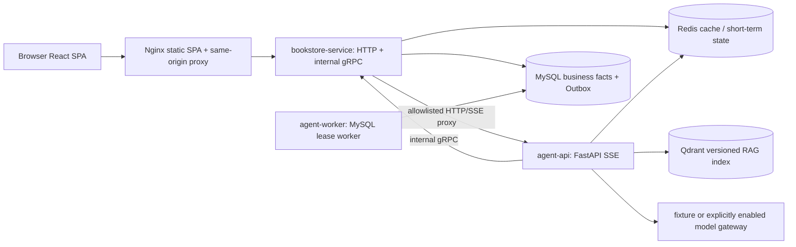

# 书店微服务系统

这是一个本地可容器化的单 Agent RAG 工程 MVP：Go `bookstore-service` 负责认证、Catalog、库存和模拟订单事务；Python `agent-api` 负责受控模型循环、工具适配、RAG 和 Trace；React/Vite 构建静态 SPA；MySQL 是业务事实和 Outbox 的权威存储。

订单必须经过预览和显式确认；补货只产生站内通知，不自动下单。Fixture 只验证协议、权限、事务和恢复边界，不能证明真实模型质量。真实模型或真实 Embedding 只有在操作者明确授权后才可运行。

规范性基线是 [V2 单 Agent RAG Spec](docs/bookstore-single-agent-rag-refactor-spec.md)。启动和验收命令见 [运行指南](docs/code-usage-guide.md) 与 [部署说明](docs/deployment.md)。

## 启动

需要 Docker Desktop（Linux 容器）和 PowerShell 7。先准备本地配置：

```powershell
.\deploy\init-local.ps1
docker compose config --quiet
```

普通 Compose 使用 `.env` 中的模型网关；它可能产生 Provider 费用，首次联调前必须单独确认范围。启动时不会自动建立收费索引：知识索引按 Spec §11.7 由操作者显式执行。

不调用外部模型时使用隔离 Fixture。空卷不能直接 `up`，使用两阶段启动器：

```powershell
.\deploy\start_v2_fixture.ps1 -Project bookstore-stage11
```

该命令只接受测试项目名，先启动依赖/Go/model-fixture，追加导入100本书并显式建立 RAG Manifest，最后启动 Agent API/Worker/Nginx；不删除卷、不清空表，也不输出密钥。

Fixture 使用专用固定测试网段，同一时刻只运行一个 Fixture 项目；启动器发现网段被占用时会提前失败，不会删除或停止其他项目。

入口：<http://127.0.0.1:8088>；验证邮件：<http://127.0.0.1:8025>。观测组件属于可选 `observability` Profile，不是默认运行依赖。

## 架构



默认本地 Compose 服务固定为 MySQL、Redis、Qdrant、Mailpit、一次性 migrate/bootstrap、`bookstore-service`、`agent-api`、`agent-worker` 和 Nginx。Node.js 只用于 Vite 构建和 Web 测试；它不是运行时服务。Prometheus、Grafana、Tempo 和 OTel Collector 只在观测 Profile 中启动；公开生产环境应换用正式SMTP等托管依赖，本仓库不声称已完成该部署。

## 功能与接口

- 注册、邮箱验证、登录、登出和 HttpOnly Cookie 会话。
- Catalog 查询、结构化过滤、书籍知识检索和有证据推荐。
- Guest 单轮咨询；登录用户的短期会话和明确结构化偏好。
- 订单预览、API 重启后的确认恢复、幂等确认和库存扣减。
- MySQL Outbox 租约 Worker 的补货监听与单条通知。
- 登录用户 Trace 时间线、模型/工具/Evidence/用量安全投影。
- 公共 `/api/evals` 与 `/api/traces/:run_id/replays` 按 V2 约定返回 404；V2 不保留业务 Replay 执行入口。

主要路径：

```text
POST /api/auth/register
POST /api/auth/verify-email
POST /api/auth/login
POST /api/auth/logout
GET  /api/session
GET  /api/books/search
GET  /api/books/:book
POST /api/chat/conversations/:id/messages
POST /api/chat/conversations/:id/confirmations
GET  /api/orders
GET  /api/orders/:order_id
GET  /api/memories
POST /api/memories/preferences
POST /api/tasks/inventory-watches
GET  /api/notifications
GET  /api/traces
GET  /api/traces/:run_id
```

浏览器请求只访问 Nginx 同源 `/api/*`。内部 gRPC 端口不发布到宿主机，JWT 只在 HttpOnly Cookie 和服务端调用链中传递。

## Fixture 验收

Fixture smoke 会创建唯一测试书籍和账号，覆盖：注册/验证/登录、Catalog 查询、Guest/Auth Chat、订单预览与 API 重启后确认、幂等订单、明确偏好、补货监听、Worker 重启、单条通知、Trace 时间线、Replay/Evals 404 和 Vite SPA 深链接。它不会调用付费模型，也不通过直写业务表伪造订单或通知结果。

```powershell
.\agent\.venv\Scripts\python.exe deploy/e2e_smoke.py --project bookstore-stage11
```

启用观测 Profile 后可验证技术 Trace、Prometheus 和 Grafana 数据源：

```powershell
docker compose --profile v2-app --profile observability -p bookstore-stage11 -f compose.yaml -f compose.e2e.yaml up -d
.\agent\.venv\Scripts\python.exe deploy/verify_telemetry.py --project bookstore-stage11
```

上述检查是 Fixture/本地基础设施证据，不是推荐质量或真实 Provider 准确率证据。推荐质量、RAG holdout 和真实模型文案必须按 Spec 单独授权、记录模型身份和费用。

## 分层测试

```powershell
$env:GOCACHE = "$PWD/.workcache/go-build"
$env:GOTMPDIR = "$PWD/.workcache/go-tmp"
go test ./...
go vet ./...
.\agent\.venv\Scripts\python.exe -m pytest agent/tests -q -p no:cacheprovider
npm run typecheck --prefix web
npm run build --prefix web
```

需要真实 MySQL/Redis/Qdrant、浏览器或 Provider 的测试必须在报告中标注运行时身份和 PASS/FAIL/BLOCKED/NOT_RUN；静态检查不能替代真实页面验收。

## 项目结构

```text
.
├── api/                 # Go HTTP/BFF、认证、Catalog、库存和订单路由
├── rpc/                 # 与 Agent 跨语言调用共用的 protobuf/模型适配层
├── agent/               # FastAPI、单 Agent、RAG、任务 Worker、Trace 和评测 CLI
├── web/                 # React/Vite 静态 SPA 与 Playwright 测试
├── deploy/              # Compose、Fixture、Nginx 和验收脚本
├── compose.yaml         # 默认本地部署；观测为可选 Profile
├── compose.e2e.yaml     # 只注入 Fixture 模型和测试 collection
├── migrations/          # 版本化 Schema；历史迁移不可原位改写
├── knowledge/           # POLICY 与 BOOK_GUIDE 来源文档
└── observability/       # 可选 Prometheus/Grafana/OTel/Tempo 配置
```

## 边界

- 这是本地工程 MVP，不宣称公开生产服务、SLA、真实支付、配送、退款或真实出版物全文。
- MySQL 是业务事实；Redis 可删除重建，只保存缓存和短期状态；Qdrant 是版本化派生索引。
- 模型不能创建订单或补货监听；确认和监听提交由确定性 API 执行。
- Fixture 只验证可重复的协议与安全边界，不能被写成真实模型质量结论。
- 停止或重启测试栈时保留数据卷；任何破坏性重置都必须先核对项目、备份和授权。
