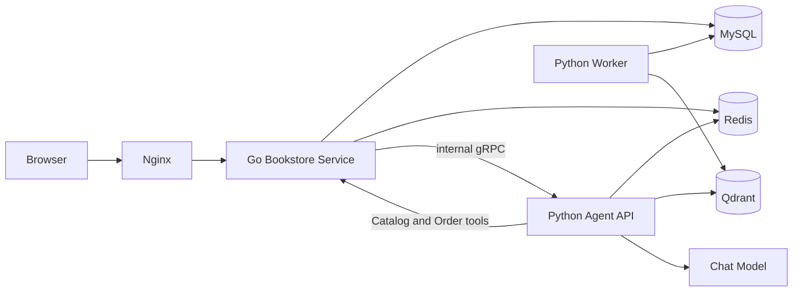

# Bookstore 单 Agent RAG 系统开发冻结 Spec

## 0. 文档控制

| 项目 | 值 |
|---|---|
| Spec 版本 | 3.0.0 |
| 状态 | `FROZEN_FOR_IMPLEMENTATION` |
| 冻结日期 | 2026-09-25 |
| 产品形态 | 本地可容器化部署的单 Agent RAG 工程 MVP |
| 适用仓库 | `书店微服务系统` |
| 规范入口 | 本文件 |

### 0.1 权威性

本文件是后续开发唯一的产品与工程规范。以下文件只能作为历史、执行记录或测试证据，不能覆盖本文件：

- `docs/bookstore-single-agent-rag-refactor-spec.md`：v2 重构与迁移历史。
- `docs/design-questions*.md`：历史设计裁决。
- `docs/*verification*.md`、`docs/*results*.md`：某次执行结果。
- 源码测试：用于证明实现；若与本文件冲突，先按第 0.3 节处理，不能让测试反向定义新需求。

本文件不复制每个既有 DTO 的全部字段。未被本文修改的字段，以 `api/bookstore.api`、`rpc/check/check.proto`、`rpc/order/bookstore_order.proto` 中的当前定义为准。路径、认证、状态机、风险等级和成功/失败语义以本文为准。

### 0.2 规范词

- **必须/不得**：验收约束。
- **应当**：除非有已登记设计裁决，否则必须遵守。
- **可以**：等价实现选择，不改变公开契约。
- **当前 Run**：一次聊天消息从 `run.started` 到唯一终态的执行。
- **业务事实**：MySQL 中的用户、书籍、价格、库存、订单、任务和通知。
- **知识证据**：由冻结 RAG Manifest 指向的 Qdrant 切片。

### 0.3 设计问题处理规则

只有以下事项不唯一时才登记 `DQ-V3-NNN` 并暂停受影响部分：

1. 会改变公开 API、数据库持久状态或迁移可逆性；
2. 会改变认证、授权、交易或隐私边界；
3. 会改变 Agent 工具权限、RAG Evidence 身份或验收门槛；
4. 两个规范性条款得出互斥实现。

登记位置固定为 `docs/design-questions-v3.md`，字段固定为：发现位置、唯一性缺口、候选方案、风险、主 Agent 决定、同步章节、验证证据。普通包名、私有函数、等价 SQL、页面样式和测试组织由实现者按现有惯例决定，不得登记为阻塞问题。

任何已决定的 DQ 必须在同一阶段同步回本文件；只写答案、不更新 Spec 视为未完成。

### 0.4 变更控制

- 文案澄清且不改变行为：补丁版本 `3.0.x`。
- 改变兼容行为、数据或验收：次版本 `3.x.0`，必须附迁移说明。
- 改变核心架构或删除公开能力：主版本升级并重新评审。
- 已被 Trace 引用的 Prompt Set、工具注册表、模型 Profile、价格表、RAG Manifest 和评测报告禁止原地覆盖，只能新增版本。

## 1. 产品目标与边界

### 1.1 必须交付的用户能力

1. 邮箱注册、验证、密码登录、会话查询和登出。
2. 按主题、作者、分类、语言、价格和库存咨询书籍；支持登录用户的当前会话追问。
3. 使用 Catalog 实时事实与 BOOK_GUIDE 证据进行推荐、比较和适读性解释。
4. 使用 POLICY 证据回答本系统订单、库存、监听、记忆和能力边界。
5. 创建订单预览；只在用户点击确认后，以 MySQL 单事务创建模拟订单并扣减库存。
6. 创建补货监听；库存达到阈值后产生一条站内通知，不自动下单。
7. 用户显式创建和删除结构化长期偏好。
8. 登录用户查看自己的脱敏线性执行轨迹。

### 1.2 明确非目标

- 多 Agent、Supervisor、DAG、A2A、LangGraph 或 Agent Checkpoint。
- 真实支付、退款、退货、换货、发货、物流和人工客服。
- 自然语言直接提交订单、离线自动购买。
- 推断式长期记忆、EPISODE 新增或语义检索。
- 在线 Replay、模型竞技场、LLM Judge、通用知识管理后台。
- 第三方登录、刷新令牌、密码找回、设备管理、多租户。
- 联网抓取或未授权出版物全文。
- 公开生产 SLA。完成本 Spec 只允许称为工程 MVP。

## 2. 固定架构



默认 Compose 运行服务固定为：`mysql`、`redis`、`qdrant`、`mailpit`、一次性 `migrate`、一次性 `bootstrap`、`bookstore-service`、`agent-api`、`agent-worker`、`nginx`。

不得重新引入独立 Add/Check/Auth/Order 进程、etcd、Redis Streams、独立 Outbox Publisher、Next.js Server 或 LangGraph。Prometheus、Tempo、OpenTelemetry Collector 和 Grafana 仅属于可选 `observability` Profile。

### 2.1 组件职责

| 组件 | 唯一职责 | 禁止职责 |
|---|---|---|
| Nginx | 静态 SPA、同源代理、SSE 透传 | 鉴权判定、业务逻辑 |
| Go Service | HTTP/BFF、Cookie、Auth、Catalog、Inventory、Order、内部 gRPC | 模型调用、向量检索 |
| Agent API | 单 Agent 循环、Context、工具适配、RAG、Evidence、Trace、SSE | 直接写价格、库存和订单表 |
| Agent Worker | MySQL Outbox 租约、监听通知、过期/清理、遗留向量删除 | 模型调用、自动订单 |
| MySQL | 所有业务与 Agent 关系数据的权威存储 | 向量相似度检索 |
| Redis | 缓存、限流、登录用户短期会话 | 权威事件总线、交易状态 |
| Qdrant | POLICY 与 BOOK_GUIDE 派生向量索引 | 业务事实、权威源文档 |

Go 进程内模块可以继续复用 `rpc/*/service` 包，但只有 `cmd/bookstore-service` 可作为运行入口。Agent 通过固定 Compose DNS `bookstore-service:9090` 调用 Catalog/Order gRPC，不使用服务发现。

## 3. 技术栈冻结

| 层 | 技术 |
|---|---|
| Web | React、TypeScript、Vite、React Router |
| 入口 | Nginx 1.28.x |
| 业务 | Go 1.26.x、go-zero 1.10.x、gRPC、Protobuf |
| Agent | Python 3.12、FastAPI、Pydantic 2、httpx、grpcio |
| 存储 | MySQL 8.0.x、Redis 7.x、Qdrant 1.15.x |
| 模型 | DeepSeek OpenAI-compatible Chat、Qwen `qwen3.7-text-embedding` 1024 维 |
| 测试 | Go Test、Pytest、TypeScript、Playwright、Docker Compose、k6 |

补丁版本可以升级；主版本、数据库、Agent 框架、事件总线或前端运行架构替换必须走 DQ。

## 4. 安全与身份契约

### 4.1 账号

- 邮箱去首尾空格并转小写；密码长度 8～128。
- 密码使用 Argon2id PHC 字符串：`m=65536KiB,t=3,p=4`、16 字节随机盐、32 字节哈希。
- JWT 使用 Ed25519，issuer=`bookstore`，默认 8 小时。
- 邮箱验证令牌使用 32 字节安全随机数；MySQL 只保存 SHA-256 摘要；有效期 24 小时且单次使用。
- 未验证用户可登录和只读咨询；订单预览、订单确认和补货监听要求邮箱已验证。

### 4.2 浏览器会话

JWT 只写入 `bookstore_access` Cookie：`HttpOnly=true`、`SameSite=Lax`、`Path=/`，生产 HTTPS 下 `Secure=true`。公开 API 忽略浏览器提供的 `Authorization` 头，只信任有效 Cookie。Go 验证后才向内部 Agent/gRPC 转换身份。

所有改变状态的浏览器请求必须满足：`Origin` 与 `APP_BASE_URL` 的 scheme、host、port 完全相同；缺少 Origin 时只接受 `Sec-Fetch-Site: same-origin`。其他情况返回 `403 REQUEST_ORIGIN_DENIED`。

### 4.3 用户隔离和秘密

- 订单、偏好、任务、通知、Trace 的 `user_id` 只能来自服务端身份，不接受客户端或模型参数。
- 跨用户资源统一返回隐藏式 404 或安全空列表。
- 密码、JWT、Cookie、验证/确认令牌、模型密钥、完整地址、隐藏 Prompt、Chain-of-Thought 和 Provider 原始响应不得进入日志、Trace、Evidence 或测试报告。

## 5. Web 与公开 API

### 5.1 页面

保留：咨询、注册、登录、验证、订单、偏好、补货任务、通知、Trace 列表和详情。删除 Replay/Evals/模型对比页面。登录后导航显示 `display_name`；悬停、点击或键盘激活均可展开菜单，菜单至少含“登出”。刷新任意 SPA 路由必须恢复页面。

### 5.2 路由与认证矩阵

| 方法与路径 | 身份 | 成功 | 关键失败 |
|---|---|---|---|
| `POST /api/auth/register` | 游客 | 202 | 400/409/429 |
| `POST /api/auth/verify-email` | 游客 | 200 | 400/409/410 |
| `POST /api/auth/resend-verification` | 登录或既有兼容输入 | 202/200 | 429 |
| `POST /api/auth/login` | 游客 | 200 + Cookie | 401/429 |
| `POST /api/auth/logout` | 任意 | 200 + 清 Cookie | 403 Origin |
| `GET /api/session` | 任意 | 200 | — |
| `GET /api/books/:book` | 任意 | 200 | 404 |
| `GET /api/books/search` | 任意 | 200 | 400/422/503 |
| `POST /api/chat/conversations/:id/messages` | 任意 | 200 SSE | 400/401/429/503 |
| `POST /api/chat/conversations/:id/confirmations` | 已验证 | 200 | 400/403/404/409/410 |
| `GET/POST/DELETE /api/memories*` | 登录 | 200 | 401/404/422 |
| `POST/GET /api/tasks*` | 已验证写、登录读 | 200/201 | 401/403/404/409 |
| `GET/POST /api/notifications*` | 登录 | 200 | 401/404 |
| `GET/DELETE /api/traces*` | 登录 | 200/204 | 401/404 |
| `GET /api/orders*` | 登录 | 200 | 401/404 |

Catalog 写接口继续作为回环地址兼容演示入口，不由 Agent 或 Web 调用；部署到非本机前必须由 Nginx 禁用或增加管理员认证。本版不创建管理员角色。

### 5.3 Session 响应

未登录：

```json
{"authenticated":false,"user":null}
```

已登录：

```json
{"authenticated":true,"user":{"display_name":"Alice","email_verified":true}}
```

不得返回 JWT、邮箱或用户 ID。

### 5.4 SSE 契约

允许事件：

```text
run.started
agent.started
tool.started
tool.completed
evidence.retrieved
agent.completed
verification.completed
confirmation.required
watch_confirmation.required
message.delta
message.completed
run.failed
```

`run.started` 必须首发；一次请求必须且只能以一个 `message.completed` 或一个 `run.failed` 结束。确认卡必须在 `message.completed` 前发送。`plan.created` 不得出现。

`message.completed` 至少包含 `content/recommendations/run_id/trace_persisted/message_id`；`run.failed` 至少包含 `code/retryable/run_id/trace_persisted`。所有 Pydantic、异常或二进制对象必须先转为 JSON 原生值。连接在终态前断开，前端显示“结果未知”，不得推断订单或任务已经完成。

## 6. Catalog 与演示数据

### 6.1 权威模型

继续使用 `book/author/book_author/category/book_category/inventory`。价格使用最小货币单位；CNY 为分。标题不是唯一标识；单书只接受 `book_id` 或 ISBN。普通用户只看到 `ACTIVE`；删除表示下架；订单已引用书籍不得物理删除。

### 6.2 查询

公开搜索支持 `q/author/category/min_price/max_price/language/in_stock/sort/cursor/limit`，`limit` 默认 20、最大 50。Agent 一次逻辑检索最多读取 4 页、200 条；第 200 条后仍有游标则返回 `QUERY_TOO_BROAD`，不得无界扫描或静默截断。

硬条件包括预算、语言、作者、分类、有货和状态，必须进入 MySQL 查询。价格、库存和状态在订单预览/提交时重新读权威数据，不依赖缓存或历史消息。

### 6.3 数据集

`deploy/datasets/manual-v1.json` 是演示 Catalog 的唯一数据文件。已有 ISBN 跳过且不覆盖；重复导入新增 0 条；不得清库、重置已变化库存或把导入伪装成补货。所有 ACTIVE 书必须有且只有一个 BOOK_GUIDE；缺卡、重复卡、ISBN/标题不一致会阻止索引切换。

## 7. 单 Agent Runtime

### 7.1 固定循环

```text
鉴权与能力摘要
→ 解析当前明确约束
→ 读取相关显式偏好和登录用户短期上下文
→ 选择确定性最小工具集
→ 调用模型得到 CALL_TOOLS 或 FINAL
→ 严格校验并执行工具
→ 登记 Evidence，注入安全结果
→ 重复或生成 FINAL
→ 确定性校验
→ 最多一次修复
→ SSE 唯一终态
```

固定预算：最多 6 次模型调用、12 次逻辑工具调用、3 个并行只读调用；同一技术失败最多重试 1 次；最终修复 1 次；请求总时限 120 秒。相同 Run 内同名且规范化参数相同的 READ_ONLY 调用只执行一次并复用结果。PREPARE 不复用该规则。

### 7.2 Context 顺序

每次模型调用依次接收：

1. 冻结 System Prompt；
2. 当前 Run 允许工具及 JSON Schema；
3. 游客/登录/邮箱验证能力摘要，不含 JWT；
4. 与任务相关的显式偏好；
5. 登录用户最近完整会话轮次；
6. 当前用户原文；
7. 按调用顺序排列的安全工具结果和 Evidence 摘要。

当前原文、System Prompt、工具 Schema 和确定性安全规则不得裁剪。超限时依次删除最旧完整历史轮次、低分 RAG 片段、非关键展示字段；价格、库存、订单和权限不得从被保留历史中当作当前事实。

最近展示书籍只提供稳定 `book_id` 和页面顺序，用于解析“第二本”等指代；后续比较、购买或 BOOK_GUIDE 检索前，Runtime 必须先通过普通 `get_book` 工具刷新本 Run 的 Catalog Evidence。该刷新计入工具预算、Trace 和 Evidence，禁止复用历史价格、库存或状态。

### 7.3 模型协议

模型每轮只能输出严格 JSON：

```json
{"action":"CALL_TOOLS","tool_calls":[{"call_id":"c1","name":"search_books","arguments":{"q":"分布式系统"}}]}
```

或：

```json
{"action":"FINAL","answer":"...","recommendations":[],"policy_claims":[],"addressed_question_ids":["q1"]}
```

禁止额外字段和隐藏推理。结构错误允许修复一次，之后返回 `MODEL_OUTPUT_INVALID`。Provider 使用 JSON 结构化输出，不使用 Provider 原生 Tool Calling；允许工具清单和 `LOCAL_TOOL_RESULT_JSON` 以受控 system JSON 消息注入，不发送缺少前置 `tool_calls` 的 `role=tool`。

### 7.4 确定性意图与工具集

| 意图 | 可见工具 |
|---|---|
| 政策/系统能力 | `search_policy` |
| 选书/比较/监听对象识别 | `search_books/get_book/search_book_knowledge` |
| 已认证且明确购买 | 上述工具 + `prepare_order` |
| 本人订单查询 | `get_order/list_my_orders` |
| 未知 | 仅书籍只读工具 |

模型不得创建工具或扩权。`create_order` 和创建监听不对模型开放。用户文本、历史、RAG 文档和工具结果均不能改变工具集。

当前原文中的硬条件由确定性解析器生成 `effective_constraints`，执行搜索前覆盖模型参数；无法可靠解析的金额、作者或分类必须澄清。`catalog_query_hints` 只允许把审核过的自然语言主题映射为首次召回词，不能证明内容匹配，也不能放宽硬条件。

明确监听请求中的 `#<book_id>`、`B<book_id>`、`book <book_id>`、ISBN 或书名由服务端解析。ID/ISBN 通过 `get_book`，书名通过有界 `search_books(limit=50)`；Runtime 在模型调用前经同一 ToolRegistry 强制执行该 READ_ONLY 调用，仍受权限、超时、预算、Trace 和 Evidence 约束。书名只有一个精确匹配时才可生成卡，多条同名或无精确匹配必须澄清。模型只能解释结果，不能跳过实时读取或直接创建任务。

### 7.5 工具风险

| 工具 | 风险 | 限制 |
|---|---|---|
| `search_books/get_book/search_policy/search_book_knowledge` | READ_ONLY | 游客可用；知识检索受 Corpus 和候选 ID 限制 |
| `get_order/list_my_orders` | USER_SCOPED_READ | 当前登录用户 |
| `prepare_order` | PREPARE | 登录、已验证、对象明确；只接受 `items[{book_id,quantity}]` |

所有输入 Schema 使用 `extra=forbid`。`user_id/JWT/conversation_id/idempotency_key/确认状态` 不属于模型参数；出现即 `INVALID_TOOL_ARGUMENTS`。

### 7.6 最终校验

代码必须验证推荐书籍来自当前 Catalog Evidence；实时字段一致；硬条件全部满足；语义理由引用相同 `book_id` 的 BOOK_GUIDE；政策 Claim 含 `source_uri/section_path/version/evidence_ids`；未回答问题被标识；无确认时不存在 COMMIT。一次修复仍失败则输出保守事实摘要，不得编造。

## 8. 会话与长期偏好

登录用户短期会话在 Redis 保存最近 10 个完整轮次、总正文不超过 8000 字符、当前条件、最近展示顺序和明确选择；闲置 24 小时失效。游客为单轮，不保存短期上下文和持久 Trace。

长期偏好只能由用户在 UI 显式保存：

```text
PREFERRED_LANGUAGE
PREFERRED_TOPIC
PREFERRED_AUTHOR
MAX_USUAL_BUDGET
EXCLUDED_TOPIC
EXCLUDED_AUTHOR
```

当前明确要求优先于偏好。临时预算不自动保存。既有 EPISODE 不注入新 Run；删除时通过 `memory.delete_requested.v1` 由 Worker 对 `LEGACY_MEMORY_COLLECTION` 做 delete-only 清理，禁止 ensure/create/upsert/query。

保存偏好前必须规范化：中文/简体中文映射为 `zh-CN`，繁体中文映射为 `zh-TW`，英文/英语映射为 `en`；常用预算保存为非负整数最小货币单位。删除后的同键偏好允许重新创建，幂等键不得永久占用该业务键。Web 必须展示规范化后的实际值。

## 9. RAG 契约

### 9.1 Corpus 和源文件

- `knowledge/policies/*.md` → `POLICY`：本系统规则与能力边界。
- `knowledge/books/*.md` → `BOOK_GUIDE`：适读人群、前置知识、核心主题、不覆盖内容、学习成果。

Qdrant 只是派生索引。实时价格、库存、订单和用户数据不得进入知识库。书籍知识是审核过的合成资料，不冒充真实出版物目录、作者观点或评价。

Front Matter 必须含 `document_id/document_type/title/version/effective_date/locale/source_type/source_uri`；BOOK_GUIDE 额外含 `catalog_ref/isbn`，POLICY 禁止这两个字段。

### 9.2 Chunk 与身份

优先按 H2 章节切分；只有章节超出目标 Token 才使用滑窗。Token 由 `cl100k_base` 工程估算，必须注明与 Qwen 内部 Tokenizer 不同。

Payload 固定含：`document_id/document_type/catalog_ref/book_id/isbn/document_title/section_path/chunk_index/version/effective_date/locale/source_type/source_uri/content/content_hash/embedding_space`。

`content_hash = SHA-256(normalized UTF-8 content)`；规范化只统一换行、移除行尾空格和首尾空白。Point ID 为 `document_id + section_path + chunk_index + content_hash` 的 SHA-256 前 128 位。环境自增 `book_id` 不参与稳定 ID 或源树哈希。

### 9.3 Embedding 与 Manifest

固定：`qwen3.7-text-embedding`、1024 维、Cosine、批次不超过 20。POLICY 和 BOOK_GUIDE 使用独立 Collection/Alias；不同模型或维度不得共用物理 Collection。在线查询只用 Alias。

Manifest 必须绑定：Schema、build ID、创建时间、Embedding、Chunk 参数、两个非零阈值、两个 Corpus 的 Alias/物理 Collection/文档与 Chunk 数/源树哈希、总源树哈希和自身规范哈希。Agent 启动必须拒绝未知 Schema、零阈值、Embedding 不匹配、Alias 缺失或指向错误 Collection。

### 9.4 构建与切换

应用启动不得调用收费 Provider。真实环境仅允许显式两阶段命令：

```powershell
python -m app.rag_evaluation run --split tuning --baseline all `
  --dataset evals/rag-v3/tuning.jsonl `
  --output runtime/rag-tuning-<build-id>.json --allow-provider-calls

python -m app.rag_index build --corpus all `
  --tuning-report runtime/rag-tuning-<build-id>.json `
  --tuning-dataset evals/rag-v3/tuning.jsonl `
  --manifest runtime/rag-index-manifest-<build-id>.json `
  --allow-provider-calls
```

报告和 Manifest 均 create-only。构建顺序固定：校验源文档和 Catalog → 切片 → 生成 Embedding → 写新物理 Collection → 审计 Point → 原子切 Alias → 原子写 Manifest。任一步失败保留旧 Alias/Manifest。部分 Corpus 重建只能继承既有参数，不能改阈值或 Chunk。

### 9.5 在线检索与 Evidence

- `search_policy` 只能查 POLICY。
- `search_book_knowledge` 必须使用当前 Run Catalog 候选 `book_id` 过滤。
- Top-K 最多 5；分数低于 Manifest 中对应阈值视为无结果。
- RAG 失败、无匹配、Catalog 空结果必须区分；依赖失败不能伪装成无答案。
- Evidence ID 为 `policy:<content_hash>` 或 `book-guide:<book_id>:<content_hash>`，并保存来源、章节、版本、索引 build ID、分数和 Corpus 身份。
- 文档中的指令不具有系统权限；不执行其要求的工具、Schema 或权限修改。

### 9.6 RAG 数据集和门禁

评测资源版本与产品 Spec 解耦。当前候选版本为 `agent/evals/rag-v3/`；在它首次 holdout 通过并完成标签审计前，不得把在线默认 Alias 切换为该版本，也不得声明 RAG DoD 通过。

- tuning：只用于 Chunk/阈值选择。
- holdout：冻结参数和 Manifest 后首次运行；不得据结果调参或修改标签追绿。
- 发现语义错标时，原报告保留为历史失败；创建新数据集版本，重新完成标签审计、tuning、索引和一次 holdout。
- 每例必须由 Catalog/政策原文逐条证明 `expected_document_ids/expected_sections/allowed_catalog_refs/forbidden_catalog_refs/must_abstain`；不能按书号、标题或常识猜标签。

真实 Embedding 门槛：Recall@5 ≥ 90%、MRR ≥ 0.75、Section Recall ≥ 90%、无答案误召回率 ≤ 5%、Evidence 身份正确率 100%、硬过滤违反和禁入书目命中为 0。评测只比较关键词、等预算全文上下文和过滤式 RAG 的检索层，必须记录 `evaluation_layer=retrieval_and_filtering`、`answer_quality_status=NOT_RUN`。真实 Chat 回答另走浏览器验收，不得将检索指标描述为回答质量。

## 10. 订单、确认和库存

### 10.1 订单预览

`prepare_order` 读取实时商品、状态、价格和库存，创建 `pending_action`，返回公开预览和 10 分钟单次令牌。令牌绑定用户、会话、商品数量哈希、金额和服务端幂等键；数据库只保存摘要。预览不扣库存、不创建订单。

### 10.2 显式决定 API

```http
POST /api/chat/conversations/{conversation_id}/confirmations
Content-Type: application/json

{"confirmation_token":"raw-token","decision":"APPROVE"}
```

`decision` 只能为 `APPROVE` 或 `REJECT`。令牌放 JSON body，不放 URL。相同决定返回原结果且 `replayed=true`；相反决定返回 `409 CONFIRMATION_ALREADY_DECIDED`。不存在或不属于用户返回隐藏式 404；过期返回 410。

批准时 Order 模块在一个 MySQL 事务中锁定动作、复核用户和邮箱、商品状态/价格/库存，条件扣库存，创建订单和快照，记录幂等结果和 Outbox，再将动作置终态。价格变化、下架、库存不足或过期不能创建订单。拒绝只将动作置 `CANCELLED` 并写审计事件。

## 11. 补货监听与 MySQL Outbox

创建监听是确认卡后的独立 API，不是模型工具。要求登录、邮箱已验证、明确 book ID 和阈值；同用户同书最多一个 ACTIVE。确认卡只能基于当前 Run 的 `get_book` Evidence 生成；仅当 `available_stock < desired_quantity` 时显示，当前库存已达到阈值则不显示卡且提交 API 返回 `WATCH_NOT_NEEDED`。状态机：

```text
ACTIVE → TRIGGERED → COMPLETED
ACTIVE → EXPIRED
ACTIVE → CANCELLED
```

库存事务同时写 `inventory.stock_changed.v1` Outbox。Worker 用 MySQL 租约领取 `PENDING` 或租约过期的 `PROCESSING` 行，按 `available_at,created_at,event_id` 排序并 `FOR UPDATE SKIP LOCKED`；领取后逐事件事务处理。失败按 `min(2^(attempt-1),300)` 秒退避，最多 10 次后 `FAILED`。`event_id` 消费主键、书籍库存版本唯一键和任务通知唯一键共同保证至少一次投递下的效果幂等。

离线触发只创建站内通知，不调用模型、不预览订单、不扣库存。未知 Outbox 类型不得被当前 Worker 领取或标记失败。

## 12. 数据迁移

- 已登记的 `000001`～`000011` 禁止修改；迁移哈希必须保持。
- 新 Schema 变化从 `000012_<name>.up/down.sql` 开始。
- 每个 Up 必须有 Down；若数据语义不可逆，Down 只能恢复兼容结构并在迁移说明中明确，不得伪造旧语义。
- 必须测试空库 Up、v1 升级、当前版本 Down→Up、dirty version 拒绝、旧数据数量/关系/库存/订单/Outbox 守恒。
- 不得在启动代码中补 Schema 或静默修改历史迁移。

当前架构所需的 `000011_single_agent_runtime` 语义继续有效：v1 `PUBLISHED` 重放为无租约 `PENDING`；`inventory.stock_changed.v1` 的 `aggregate_type` 统一为 `INVENTORY`；任务不再保存图 Checkpoint。

## 13. Trace 与可观测性

登录用户的 Chat 写 `agent_run` 和线性步骤：MODEL、TOOL、RAG、VALIDATION、SYSTEM。`dag_json=NULL`、`replayable=false`，不写新 Replay Fixture。Trace 保存版本、脱敏输入输出、Evidence、Token/费用状态、耗时、错误和最终回答；不保存秘密和隐藏推理。

公开只保留 `GET /api/traces`、`GET /api/traces/:run_id`、`DELETE /api/traces/:run_id`。历史 Replay 数据仅数据库兼容，不提供执行入口。

## 14. 错误模型

统一响应：

```json
{"error":{"code":"INVENTORY_INSUFFICIENT","message":"库存不足，请重新选择数量","retryable":false,"trace_id":"..."}}
```

必须至少实现：`AUTH_REQUIRED/AUTH_INVALID_CREDENTIALS/EMAIL_NOT_VERIFIED/REQUEST_ORIGIN_DENIED/RATE_LIMITED/BOOK_NOT_FOUND/BOOK_INACTIVE/QUERY_TOO_BROAD/INVENTORY_INSUFFICIENT/CONFIRMATION_NOT_FOUND/CONFIRMATION_EXPIRED/CONFIRMATION_ALREADY_DECIDED/PRICE_CHANGED/IDEMPOTENCY_CONFLICT/WATCH_NOT_NEEDED/TASK_NOT_FOUND/DEPENDENCY_UNAVAILABLE/INVALID_TOOL_ARGUMENTS/TOOL_PERMISSION_DENIED/TOOL_TIMEOUT/TOOL_BUDGET_EXCEEDED/MODEL_OUTPUT_INVALID/MODEL_CONTEXT_EXCEEDED/EVIDENCE_MISMATCH/RAG_RESULT_UNAVAILABLE`。

400/422 表示输入；401 未认证；403 权限或邮箱状态；404 隐藏资源；409 状态冲突；410 过期；429 限流；503 必需依赖失败。业务错误不得统一返回 500。

## 15. 配置与启动

`.env.example` 与 `compose.yaml` 必须同步。生产/真实模型环境缺少密码、JWT 密钥、HMAC、模型/Embedding Key、HTTPS 模型端点或兼容 RAG Manifest 时启动失败。代码不得有生产默认密钥。

关键配置固定包括：MySQL 四类账号密码/DSN、`REDIS_ADDR/QDRANT_URL`、JWT 路径和 issuer、`APP_BASE_URL/COOKIE_SECURE`、Go HTTP/gRPC 地址、SMTP、Chat/Embedding 网关、模型名、`MODEL_PROFILE/PROMPT_SET_VERSION`、RAG Alias/Manifest、Agent 预算、确认 TTL、Outbox 租约、监听 TTL、Trace 保留和游客限流。

当前在线 Prompt 为 `v4.2-single-agent-rag`；修改任何文本或 Schema 必须发布新 Prompt 版本并保留旧哈希。真实 RAG v3 已通过首次 holdout 并切换到验证 Alias/Manifest；以后任何新版本仍必须先通过独立 holdout，默认 Compose 在此之前继续使用最后一个已验证 Alias/Manifest，不能只因新索引构建成功就切流量。

## 16. 实施顺序与阶段门

1. **冻结**：记录提交、迁移哈希、公开 API、数据集哈希、当前在线 Prompt/工具/RAG Manifest。
2. **RAG 数据审计**：逐例核对 tuning/holdout 标签与原始书目/政策；错误则发布新数据集版本。
3. **真实 tuning**：create-only 报告达到门槛；未通过先修知识或检索设计。
4. **隔离索引**：构建新 Collection/Alias/Manifest，完成 Point 与源树审计，不切默认流量。
5. **首次 holdout**：只运行一次；通过才允许切换默认 Alias；失败保留证据并进入新版本循环。
6. **业务回归**：Go、Python、Web、迁移、Compose Fixture 全部通过。
7. **真实 Chat 验收**：只读咨询先执行；写旅程使用隔离账号和数据，记录授权边界。
8. **文档收敛**：更新运行指南、验证快照和项目表述；删除互相冲突的当前态描述。

阶段之间不得用删除失败测试、改写历史报告或把 Fixture 当真实模型证据获得绿色结果。

## 17. 测试与验收

### 17.1 自动门禁

| 层 | 必须执行 | 通过条件 |
|---|---|---|
| Go | `go test ./...`、`go vet ./...` | 0 fail |
| Python | `pytest agent/tests` | 0 fail；显式外部依赖跳过需记录 |
| Web | typecheck、Vite build、Playwright | 0 fail |
| 迁移 | clean、upgrade、Down-Up、dirty、哈希 | 全部 PASS |
| Compose Fixture | 认证、Catalog、咨询、确认、幂等、监听、Trace、404 删除入口 | 全部 PASS |
| RAG | 标签审计、tuning、索引审计、首次 holdout | 达第 9.6 门槛 |
| 安全 | 跨用户、Origin、Cookie、Schema、秘密扫描、Prompt Injection | 0 严重失败 |

### 17.2 浏览器验收

以 `docs/browser-test-cases-v2.md` 为当前用户旅程清单；执行结果必须另写报告，不回写用例定义。真实 Chat 需覆盖首页三书、多轮条件、比较、语义查询、政策有答案/无答案、Prompt Injection。认证写旅程覆盖偏好、订单预览、拒绝/批准、Agent 重启恢复、监听、Worker 重启、通知和 Trace。

状态只允许 `PASS/FAIL/BLOCKED/NOT_RUN`，并记录 URL、Compose 项目、镜像/提交、数据库、模型、Prompt、RAG Manifest、测试数据和费用授权范围。Fixture 只证明协议和确定性行为；HTTP 脚本不能冒充页面视觉验收；未获授权的真实写操作必须为 NOT_RUN 或 BLOCKED。

### 17.3 完成定义

只有以下全部满足才可宣布 3.0 完成：

- 第 17.1 自动门禁全绿；外部依赖跳过有等价 Compose 证据。
- 当前 RAG 数据集已完成逐例标签审计，真实首次 holdout 达标并切换默认 Manifest。
- 第 17.2 的必需真实页面旅程 PASS；授权外的可选破坏性步骤可 BLOCKED，但不得包含交易、安全、跨用户或严重事实正确性的缺口。
- 订单确认重试不重复建单或扣库存；Worker 重启不丢任务或重复通知。
- 所有 ACTIVE 演示书有且只有一个合法 BOOK_GUIDE；索引无缺失、重复和陈旧 Point。
- 所有公开 API 同源；JWT 只存在 HttpOnly Cookie 与内部服务链路。
- 默认 Compose 不含已删除运行层，应用启动不调用收费 Provider。
- 当前文档间无互斥描述，`unresolved_DQ_V3=0`。

## 18. 开发交付要求

每个阶段提交必须包含：代码、最小必要测试、迁移（若有）、本文件的契约同步、阶段级 operation/engineering 日志和实际验证结果。执行者不得擅自增加功能来解决局部问题；优先修复共享根因并复用现有依赖。

交付总结必须明确区分：已实现、自动测试通过、Fixture 通过、真实模型通过、人工页面通过、未运行和已知限制。不得把“本地可部署”写成“生产上线”，不得把单 Agent 描述成多 Agent，也不得把 RAG 检索指标描述成最终回答质量。
